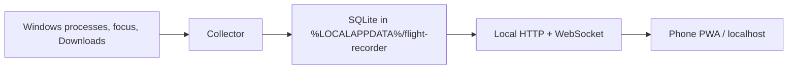

# Flight Recorder

A local black box for your PC — apps, downloads, builds, errors, CPU spikes, crashes — as a searchable timeline on your phone.

This is a **timeline**, not a live gauge and not Event Viewer. It is not a keylogger, not a spyware demo, and not a cloud analytics product.

**Not for:** employers silently monitoring staff, or anyone spying on another person. Run it only on a machine you are allowed to inspect. See [docs/PRIVACY.md](docs/PRIVACY.md).

## Architecture



## Quick start (Windows)

Needs Node.js 22+.

```bash
git clone <this-repo>
cd flight-recorder
npm start
```

Open the printed `http://127.0.0.1:7842` URL. From a phone on the same Wi-Fi, open the LAN URL and enter the pairing code from the PC console (or from Settings on localhost).

Demo mode seeds anonymized events, skips the collector, and stays on this PC:

```bash
npm run demo
```

## Network

The recorder listens on this PC and, unless you are in demo mode, on the local network so a phone can open the timeline.

- Demo mode (`npm run demo`) binds to `127.0.0.1` only. It serves the sample reel and does not record.
- Localhost can read the timeline without a code. Every other device must enter the pairing code shown in the PC console or in Settings on localhost.
- A wrong code is rate-limited. The code expires after 10 minutes; refreshing it does not invalidate a phone that already paired.
- Other websites cannot read the API. The server rejects cross-site browser requests and any `Host` that is not this machine.
- The pairing code is never included in responses to other devices.

## What gets recorded

| Kind | Meaning |
| --- | --- |
| `app.open` / `app.close` | Watched process start/exit |
| `app.focus` | Foreground app changed |
| `download` | New file name in Downloads (path, not contents) |
| `build` | Sustained CPU on `node` / `cargo` / similar |
| `cpu.spike` / `mem.spike` | Process over threshold with hysteresis |
| `crash` | Best-effort: Windows Error Reporting appeared |
| `error.user` | You tapped **Mark a moment** |

Background `svchost` noise is ignored until you turn on **Background processes** in Settings.

## Product rules

1. **Local disk only.** SQLite under `%LOCALAPPDATA%\flight-recorder`.
2. **Retention** defaults to 7 days (`24h` / `7d` / `30d`).
3. **The phone is a viewer**, not a second recorder.
4. **Search** is the feature: time range + text + kind chips.
5. **Mark a moment** drops a pin so “that lag” has a timestamp.

## Controls

- Pause / resume from the tray icon, Settings, or `POST /api/pause`
- Wipe database in Settings
- Export last 24h JSON from the timeline header
- `npm start -- --no-tray` if you do not want the notify icon

Crash detection is best-effort. This is not Procmon, not Datadog, and not a syscall log.

## Stack

Node.js built-ins only (`node:sqlite`, `node:http`). PowerShell snapshots processes and the foreground window. The UI is a zero-build PWA in `web/`.

## License

MIT
